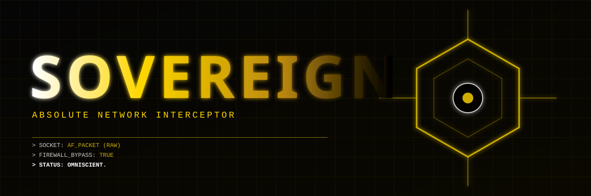

<div align="center">
  
  
  <h1>SOVEREIGN</h1>
  <p><b>THE ULTIMATE NETWORK INTERCEPTOR.</b></p>
  
  
  
  
</div>

---

## 👁️ WHAT IS SOVEREIGN?

Every firewall, every antivirus, and every security appliance in the world operates on **Layer 7** (Application) or **Layer 4** (Transport). They intercept data *after* it has passed through the operating system's kernel.

**SOVEREIGN operates on Layer 2 (Data Link).**

This project is a raw network interceptor written in pure Rust. It uses the `AF_PACKET` socket family to bind directly to the network interface card (NIC) and read every single Ethernet frame that passes through the wire. It bypasses the OS TCP/IP stack entirely. 

If a packet is on the network, SOVEREIGN sees it. It doesn't matter if it's encrypted with AES-256, if it's a VPN tunnel, or if the OS firewall is set to "Block All". The packet is captured before the kernel even knows it exists.

## ⚡ CORE CAPABILITIES

*   **Kernel Bypass:** Firewalls (iptables, ufw) cannot block what they cannot see. SOVEREIGN reads raw hardware buffers.
*   **Promiscuous Mode:** It captures *all* traffic on the local network segment, not just traffic destined for your MAC address.
*   **Zero Dependencies:** No `pcap`, no `libpcap`, no external crates. Pure `libc` FFI and Rust.
*   **Real-time Parsing:** Extracts IPv4 headers, source/destination IPs, protocol types (TCP/UDP/ICMP), and TTL directly from raw bytes.

## 📊 CAPABILITY MATRIX

| Level | Traditional Sniffer (Wireshark) | SOVEREIGN (Raw AF_PACKET) |
| :--- | :--- | :--- |
| **OS Overhead** | High (copies data to userland) | **Zero** (Direct hardware read) |
| **Firewall Evasion** | No (Runs above firewall) | **Yes** (Runs below firewall) |
| **Dependencies** | `libpcap`, `glibc`, huge stack | **None** (Pure `std` + `libc`) |
| **Visibility** | Limited by OS permissions | **Absolute** |

## 🛠️ DEPLOYMENT

> ⚠️ **WARNING:** This tool requires root privileges (`CAP_NET_RAW`) to open raw sockets. It does not modify traffic; it only observes. However, using it on networks you do not own is illegal.

```bash
# Compile the interceptor
rustc -O main.rs -o sovereign

# Run it on your network interface (eth0, wlan0, etc.)
sudo ./sovereign eth0
